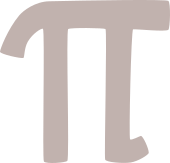

# SearchingPie
indexed pi(e) — yum yum yummy!  

### quick setup
visit SearchingPie [here](https://kpoovakan.github.io/searchingpie), no setup needed. enter any sequence of numbers (eight digits long or less) and search for its index (location) in the first hundred billion digits of pi!

### how were these digits calculated?
these digits of pi were calculated by the original creator, [aha-ha](https://github.com/aha-ha)! this is some of the info provided by aha-ha regarding the calculations:
> I used [Y-cruncher](https://en.wikipedia.org/wiki/Y-cruncher) to calculate pi. 100 billion digits need about 450 GiB of RAM, so you will probably need to rent a server for this (so did I). If you want to calculate pi on your own pc, depending on your free ram, you can calculate 1b (~4.5GiB), 2.5b (~11GiB), 5b (~22.5GiB) or even 10b (~45GiB). You can also download my calculated digits of pi from the Internet Archive [here](https://archive.org/details/100b-digits-of-pi).

### credits and licensing
many thanks to [aha-ha](https://github.com/aha-ha) for the original project! this project is a fork of [the original](https://github.com/aha-ha/pisearch). all CSS features, as well as a few additional features, were added by [kpoovakan](https://kpoovakan.github.io).